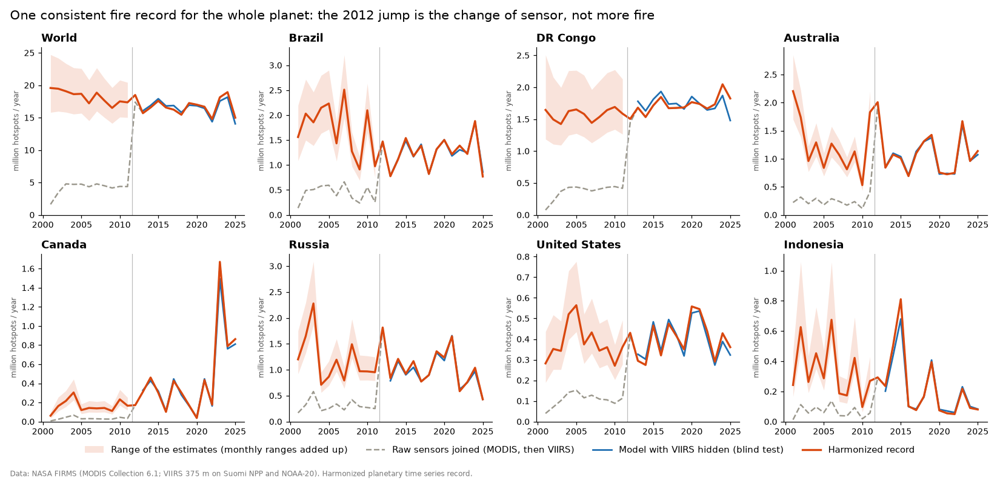

# Ember-Relay: Burning Activity Calendar

**One consistent fire record for the whole planet, from MODIS to VIIRS and beyond.**
NASA Space Apps Challenge 2026 · challenge: *Harmonization of MODIS and VIIRS Hot Spots*.

MODIS has recorded fire hotspots since 2000 and is still flying; VIIRS joined in 2012 and records about four times
as many fire pixels. This project converts the MODIS years into VIIRS-equivalent counts for every 25 km cell on
Earth, so the record runs without the sensor step from November 2000 to this week, and shows it as a calendar for
any country or any area you draw.



- **What we built, how it works and every test result:** [SUBMISSION.md](docs/SUBMISSION.md)
- **Every number of the final run:** [RESULTS.md](docs/RESULTS.md)
- **The experiments, including the ones that broke our first model, and the review that rebuilt the pipeline:**
  [EXPERIMENTS.md](docs/EXPERIMENTS.md)
- **Project demo (7 slides):** [demo/slides.pdf](demo/slides.pdf)
- **The live app** (once the repository is public): https://prnshu-p.github.io/Ember-Relay/

## What the app does

- Search a country, draw a box on the map or type coordinates, and choose the years.
- **Calendar** of hotspots for every month since 2000, as a count or against the median of that calendar month.
- **Map** of where it burned: the whole period, or the month you click. 1° boxes for the world, 25 km cells for an area.
- **Fire season** (a typical year against any year) and the **yearly record** (raw sensors against harmonized, with the
  range of each estimate and the model's blind test). Hover for the numbers.
- **How good is it here?** Every area shows its own blind test and its step at 2012, where the sensors meet.
- **Downloads:** the monthly table (CSV), hotspots per cell (CSV) and the calendar picture (PNG).
- Light and dark themes, keyboard access, colour-blind-safe colours. The address keeps the view, so it can be shared.

## Run it

The app is a static site: it reads `frontend/public/world/` and computes every number in the browser.

```bash
cd frontend && npm install && npm run dev      # http://localhost:5173
npm run build                                  # static site in frontend/dist, works from any folder
```

Pushing to `main` publishes it to GitHub Pages (`.github/workflows/pages.yml`) once the repository is public and
Pages is set to "GitHub Actions".

## Rebuild the world record from NASA's files

```bash
pip install pandas numpy scipy scikit-learn pyarrow matplotlib h5py playwright && playwright install chromium
sh pipeline/download_archive.sh                           # FIRMS yearly world archives, 2000-2025 (about 10 GB, no login)
FIRMS_MAP_KEY=... python3 pipeline/download_api.py world  # 2026 from the FIRMS API (free key)
python3 pipeline/stage1_prepare.py   # detections -> monthly statistics per 0.25 degree cell, daily counts per satellite
python3 pipeline/stage2_model.py     # outages, the model, its tests, the harmonized record (about 30 min on 8 cores)
python3 pipeline/burned_area.py      # check against burned area (downloads 1.3 GB, no login)
python3 pipeline/stage3_export.py    # compact files for the app: frontend/public/world/
python3 pipeline/report.py           # docs/RESULTS.md, SUBMISSION.md and SUBMISSION_FORM.md from the run's numbers
python3 pipeline/test_app_data.py    # the browser code, the files and the model arrays agree (needs node)
python3 pipeline/figure.py           # demo/record.png
TEAM="..." MEMBERS="..." python3 demo/build_slides.py  # demo/slides.pdf (app running on :5173)
```

The run's metrics and logs are kept in `data/global/model/` (`metrics.json`, `burned_area_check.json`, `stage2.log`):
`report.py` rebuilds the documents from them without rerunning the model. The tables between the stages (cell
statistics, model arrays, the 2026 downloads) are attached to the repository's "data" release.

Keys and passwords are never stored in this repository. The raw FIRMS files are large and are not committed; the
app's data (`frontend/public/world/`, about 70 MB) is.

## Layout

```
pipeline/
  common.py              paths, month index and grid helpers
  download_archive.sh    FIRMS yearly archives
  download_api.py        FIRMS API (2026, and the extra sensors used in the tests)
  stage1_prepare.py      hotspots -> cell statistics
  stage2_model.py        the model, its tests and the harmonized record
  stage3_export.py       data files for the app
  burned_area.py         independent check against burned area
  report.py, templates/  the documents in docs/, filled from the run's numbers
  figure.py              demo/record.png
  test_app_data.py       parity test: browser code vs. Python
  experiments/           E11-E15 of docs/EXPERIMENTS.md
frontend/src/
  App.jsx                page layout and state
  hooks.js               address bar, theme, data and tile loading
  components/            map, calendar, charts and panels
  lib/world.js           reads the data files and computes every number the app shows
  lib/                   formatting, colours, place names, downloads
docs/                    write-up, results, experiments, form text
demo/                    slides and the figure
```

The scripts of experiments E1-E8 ran on an earlier regional prototype; they are in the history at commit `1718f88`.

## Data and credits

- **NASA FIRMS** active fire hotspots: MODIS Collection 6.1 (Terra, Aqua) and VIIRS 375 m Collection 2 (Suomi NPP,
  NOAA-20); yearly world archives 2000-2025 and the FIRMS API (standard and near-real-time) for 2026. For the
  tests only (E13-E15): VIIRS on NOAA-21, Landsat 8 and 9 active fire, and GOES-16 fire detections, from the API
  (`FIRMS_MAP_KEY=... python3 pipeline/download_api.py extra`). We acknowledge
  the use of data from NASA's Fire Information for Resource Management System (FIRMS)
  (https://earthdata.nasa.gov/firms), part of NASA's Earth Science Data and Information System (ESDIS).
- Burned area for the independent check: ESA Fire_cci FireCCI51 (Lizundia-Loiola et al. 2020) and GFED5 (Chen et al.
  2023). Not redistributed here; the script downloads them.
- Base map: © OpenStreetMap contributors. Region boundaries for the regional experiments: Natural Earth.
- Software: Python (pandas, NumPy, SciPy, scikit-learn, PyArrow, h5py, Shapely, Matplotlib), React, Leaflet,
  react-leaflet, Vite, Inter typeface, Playwright. Full references in [SUBMISSION.md](docs/SUBMISSION.md).

