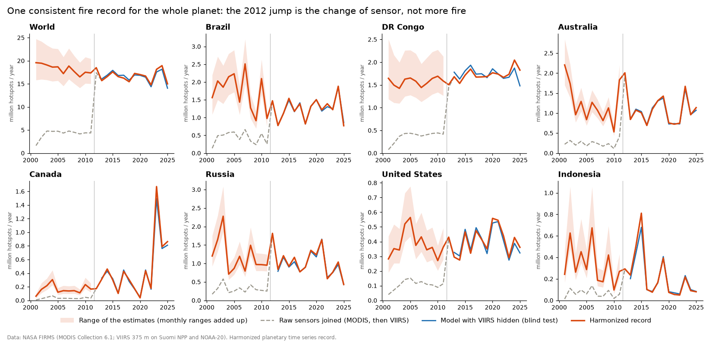

# Burning Activity Calendar: one consistent fire record for the whole planet

Technical write-up. Every number of the final run is in [RESULTS.md](RESULTS.md). The experiments that led here,
the ones that broke our first model and the multi-stage validation experiments that stress-tested and rebuilt the pipeline are in
[EXPERIMENTS.md](EXPERIMENTS.md). The text for each field of the Space Apps project form is in
[SUBMISSION_FORM.md](SUBMISSION_FORM.md).

**In one line:** we turn 26 years of MODIS and VIIRS fire detections (489 million hotspots) into one consistent,
VIIRS-equivalent monthly record for every 25 km cell on Earth, November 2000 to this week, with tested ranges on
the estimates, and show it in a web calendar that answers "is this month unusual, and where is it burning?" for
any country or any area you draw.

**Headline results**
- **Finer than a ratio can go.** On years hidden from the model, the error of 1° box-months is **18.2%** against
  20.3% for the best simple method we could build and 25.1% for a ratio per country and calendar month;
  per 25 km cell (log scale) **0.71** against 0.84 and 1.13.
- **Countries.** Median error of monthly totals 17.5% against 19.8% for the ratio per calendar month
  when the test crosses the years in which MODIS's orbits drift; in the test without drift the two are level
  (17.2% against 17.2%). The gain at country size is in the big fire months: weighted by
  fire, 7.2% against 8.9%.
- **Small steps where the sources change.** At 2012, where VIIRS begins, the world's record steps by
  **+2.4%** against MODIS (the raw sensors joined: +304%). Against burned-area maps, which use no
  VIIRS data, the estimated years sit 8% [4, 13] below the VIIRS years, where the raw join sits 77% below. At
  July 2002, where Aqua joins Terra, the step is +2.4%.
- **Ranges that hold.** Each estimate carries a range that contains the real value 90% of the time for
  countries in a cross-period test (93% weighted by fire), after we widened them to make that true.
- **Every satellite's outages found and corrected** for Terra, Aqua, Suomi NPP and NOAA-20 (44
  months lost 3% or more of a satellite), and the record continues on NOAA-20 after Suomi NPP's data ended on
  2 November 2026.
- **Tested with three more NASA sensors.** A third VIIRS (NOAA-21), Landsat's 30 m fire pixels and the GOES
  geostationary satellite check the benchmark, the outage repairs, where the record puts fire, and why conversions
  age (E13–E15).
- **Reviewed before release.** Six independent validation audits, each stress-testing one part of the project, found a
  defective model input, a download bug and several overstated claims. All are fixed or stated here (E10).

## The problem
MODIS has recorded active fires since November 2000 (Terra) and July 2002 (Aqua) and is still operating, well past
its design life. VIIRS on Suomi NPP has recorded them at 375 m since 20 January 2012. With our filters one VIIRS
records about four times as many fire pixels as the two MODIS instruments together (3.2 to 8.3
times in nine countries out of ten): smaller pixels, a lower detection threshold, a wider swath. More fire pixels,
not four times more fires. Joined as counted, the world's record steps by +304% in 2012. That step is the
change of sensor, and it hides the long history fire managers need to judge whether this month is unusual.

## What we built

### 1. The data, put in order
- **Source.** NASA FIRMS [1] active-fire detections for the whole planet: MODIS Collection 6.1 (MCD14ML, and MCD14DL
  near-real-time) and VIIRS 375 m Collection 2 from Suomi NPP and NOAA-20 (VNP14IMGML, VJ114IMGML and their
  near-real-time forms). Yearly world archives for 2000–2025, the FIRMS API for 2026, to 2026-11-13.
- **Filters.** Presumed vegetation fires (FIRMS type 0) of nominal or high confidence (MODIS: 30% or more) [2, 12],
  per 0.25° cell and month.
- **Near-real-time months.** From August 2026 (VIIRS) and September 2026 (MODIS) the data carry no fire-type flag.
  There we remove gas flares, industry and volcanoes by place: every spot the standard product flagged since 2023,
  and the spots next to it. On the typed months of 2026 this removes 92% of VIIRS's other sources
  (81% of MODIS's) and 1.1% of the fires, leaving a net error of -0.2% where no
  mask would leave +10%.
- **Persistent heat sources.** 206 cells in which the same spots are detected over and over (lava next to a
  flagged volcano, or flares and industry that slipped the type flag for four months within a year) are left out;
  peat fires and the longest forest fires stay.
- **Outages.** From the world's detections per day and satellite we find the days each satellite lost
  (90 runs; the long ones match NASA's outage notices [12, 13]). Terra's and Aqua's counts are scaled up by the share of the
  month they lost; Suomi NPP's lost share is filled from NOAA-20. Months that lost more than a fifth of a satellite
  are kept out of training.
- **Countries.** A border cell counts for each of its countries by the share of the hotspots each had there.

### 2. The harmonization model
For every 0.25° cell where either sensor ever saw a vegetation fire (189,999 cells) and every month, a
gradient-boosting model with a Poisson loss estimates how many fire pixels VIIRS would have recorded.

- **Every cell, every month, zeros included.** VIIRS finds fires in places and months where MODIS finds none. A
  model that only converts where MODIS saw fire loses them before 2012 (our first model did: E1). This one
  estimates them from the cell's small-fire climatology, its neighbours and the season.
- **Inputs with a physical reason.** MODIS counts split by satellite and day/night (Aqua and Suomi NPP were both
  placed at a 13:30 equator crossing, Terra at 10:30, so Aqua sampled the same part of the daily fire cycle as
  VIIRS), fire radiative power, pixel size, confidence, how the month's detections spread over days and 1 km
  pixels, counts in the 8 neighbouring cells and the adjacent months, the cell's MODIS and small-fire climatology
  (both leaving the row's own month out), season and location.
- **Trained where the orbits were stable.** Terra's orbit has drifted since 2020 and Aqua's since 2022 [11]. Read
  from their own fire detections over tropical South America, Terra now observes at 8:46 local time
  instead of 10:32, and Aqua at 15:26 instead of 13:41; the relation between the sensors moved with them (E15).
  The models that make the record are trained on 2012–2019 only.
- **Before Aqua.** Until July 2002 only Terra supplied fire data. Those 20 months use a second model whose inputs
  for the month come from Terra alone. Its estimates are tied to the rest through the years in which both models
  can run (July 2002–January 2012): multiplied by the ratio of the two per 10° tile and calendar month (E11).
- **Box totals.** Each 1° box total of the record is the average of the model and the best simple method (a local
  seasonal ratio, plus each cell's usual small fires where MODIS saw nothing); the model keeps the detail between
  cells. This costs a few tenths of a point on blind-test world totals and buys continuity: the median country step
  at 2012 falls from 6.2% to 3.9% (E3, E10).
- **One pair of models for the world** (full inputs, and Terra-only), trained everywhere at once. The settings were
  chosen on validation years (E8).

### 3. A second VIIRS
NOAA-20 carries a VIIRS of the same design in Suomi NPP's orbital plane: half an orbit (about 50 minutes) from it
until NOAA-20 was re-phased in March–April 2024, about a quarter orbit afterwards. We use it three ways:
- as a **benchmark**: how well one VIIRS reproduces the other, cell by cell and month by month, shows how much
  disagreement is normal between two good sensors. It is a measured reference, not a theoretical limit;
- to **fill Suomi NPP's outages**: the share of a month S-NPP lost is taken from NOAA-20, scaled per 10° tile by
  their ratio over the 24 healthy months before (18 months had 3% or more filled this way);
- to **continue the record** after Suomi NPP's data ended on 2 November 2026.

### 4. A range on every estimate
Each estimated month carries a range: the 3rd to 97th percentile of the blind-test errors of similar months in the
same area. Tested across periods, those alone were too narrow (84% of country-months inside,
68% weighted by fire), because the relation between the sensors drifts. So every range is widened by
±9%, the smallest amount that puts the real value inside 9 times in 10 by both counts, by a further
0.5% for each year before 2012, and by 1.35 times on the error part before July 2002. The first
widening is tested; the two for earlier years are rules drawn from the tests, which no data can check.

### 5. The web app
A static site: every number is computed in the browser from compact files, so it can be hosted anywhere.
- Search a country, draw a box or type coordinates; choose the years.
- Calendar of every month since 2000, as counts or against the median of that calendar month; the rank of each month
  among the same calendar month of other years; estimated months hatched; outage months noted in the read-out.
- Map of where it burned (1° boxes for the world, 25 km cells for an area), for the period or the month you click,
  and a **trend map**: where fire is rising or falling per decade.
- Fire-season chart and the yearly record (raw against harmonized, with the blind test and the ranges).
- "How good is the record here?": every area shows its own blind test and its step at 2012.
- Downloads: monthly table and cells (CSV), calendar picture (PNG). Light and dark, keyboard access, colour-blind-safe.

## How we know it works
All scores are on months the model was not trained on, on the complete grid. Three tests: **forward** (trained on
2012–2018, tested on 2019–2025), **backward** (the reverse) and the **analogue** of the real task (trained on
2016–2019, tested on 2012–2015: backward in time with stable orbits on both sides, as when 2000–2011 is estimated).

| Error on hidden years | Countries: forward and backward | Countries: analogue | 1° boxes: f. and b. | 1° boxes: analogue | Cells (log): f. and b. | Cells: analogue |
|---|---|---|---|---|---|---|
| Twin VIIRS sensor (benchmark, 69 months of 2019–2025) | 8.6% | | 10.4% | | 0.62 | |
| **The record** | **17.5%** | **17.2%** | **18.2%** | **17.0%** | **0.71** | **0.70** |
| Best simple method (local ratio + the cell's usual small fires) | 19.2% | 18.6% | 20.3% | 19.4% | 0.84 | 0.86 |
| Ratio per 1° box and calendar month | 19.9% | 17.2% | 21.5% | 20.3% | 1.12 | 1.10 |
| Ratio per country and calendar month | 19.8% | 17.2% | 25.1% | 24.0% | 1.13 | 1.11 |
| One ratio per country | 25.3% | 23.8% | 26.7% | 25.9% | 1.13 | 1.12 |

Countries: median error of monthly totals (months with 20 or more real hotspots), median over 166
countries. Boxes: median over box-months with 50 or more real hotspots. Cells: log-RMSE where either sensor saw fire.

- **What the model adds, and what it does not.** Below country size the record beats every simple method in every
  test. At country size a ratio per calendar month is already hard to beat when the orbits are stable; the record
  beats it in 119 of 166 countries across the drift years, and in the months with most fire.
- **The benchmark.** Two VIIRS of the same design disagree by 8.6% per country-month. The record closes
  56% of the gap between the best simple method and that benchmark per cell, 19% per box and
  11% per country (RESULTS.md gives the months each figure rests on).
- **Steps.** If the conversion loses or invents no fire, and the mix of fires does not change, record / MODIS is
  the same before and after 2012: the step
  is +2.4% for the world (model alone +2.8%, best simple method alone +2.1%); across
  countries the median absolute step is 3.9%, and 55% are within ±5%. A fixed ratio passes this test by
  construction, so it detects lost fires (E1), not accuracy. At July 2002, against Terra, which flew through:
  +2.4% (+5.1% before the Terra-only months were bridged to the rest, E11); the same statistic
  inside real VIIRS data is +0.6%.
- **Burned area, a yardstick without VIIRS.** Burned area is mapped from surface reflectance by one sensor family
  that flew unchanged across 2012 (it is not fully independent: both products start from MODIS hotspots). In hotspots
  per km² burned, the estimated years sit 8% [4, 13] below the VIIRS years in the record (ESA FireCCI51 [15];
  3% below with GFED5 [16]), 77% below in the raw join, and 6% below for MODIS alone, which
  shows how much the yardstick itself moves. Year-to-year agreement with burned area is as good in the estimated
  years (r = 0.88 over 14 regions) as in the VIIRS years (0.79), though that is partly built in. The
  check fails in both products in temperate North America and boreal Asia. In boreal Asia the estimated years sit 29% below; MODIS alone
  accounts for most of it and 13 points are specific to our estimates. Splitting Russia's step by place and season (E12) shows two thirds of that is a
  real change in the fires (summer forest fire in the north doubled its share); about 5% is unexplained.
- **Ranges.** After widening, the real value falls inside 90% of the time for countries
  (93% weighted by fire), 90% for 2° boxes and 93% for 0.5° boxes.
- **Why conversions age.** Fire has a daily cycle. GOES, which scans the Americas every 10 minutes, shows it
  (662,867 detections): in tropical South America it peaks at 14:45, and at 09:00 a sixth as much burns as at
  13:30. Evaluated at Terra's actual observing hour each year, the cycle predicts Terra's daytime count per VIIRS
  hotspot: observed 0.47 of its former level in 2026, predicted 0.36, correlation
  0.97 over 2012–2026 (E15). There, Terra's evening pass and Aqua's afternoon make up most of the loss
  (all of MODIS: observed 1.03, predicted 0.90), so the drift is a measured mechanism but
  not the whole of the worldwide shortfall below.
- **2026.** On the 10 whole months of 2026, which no model was trained on, every method reads low
  (-13% for the record); the record's country error
  is 19.6% against 23.5% for the ratio per calendar month and 27.7% for one ratio. A conversion
  trained on earlier years ages as MODIS drifts; this is a warning for anyone converting recent MODIS data.
- **A third VIIRS** (NOAA-21, 25 months in which none of the three lost a day; E13). NOAA-21 predicts
  Suomi NPP with a 1° box error of 10.0% (NOAA-20: 10.0%; the two averaged: 8.5%); the record,
  from MODIS, 21.1% on the same months. Comparing the three pairwise, each VIIRS has an own random error
  of about 0.12 to 0.13 (log standard deviation per box-month); the record's own is 0.39. NOAA-21
  was normal on the outage days of S-NPP and NOAA-20 in 21 of 21 runs, and refilling S-NPP's lost days
  from NOAA-21 instead of NOAA-20 changes those months' world totals by at most 0.8%.
- **Landsat** (30 m pixels, US and Canada south of 50°N; E14). Where the record has 100 or more hotspots in a cell
  and month, Landsat saw fire there 80% of the time; where Landsat saw fire, the record has it in
  54%: Landsat finds many burns too small or too short for VIIRS. Monthly totals rise and fall together
  (rank correlation 0.60 over 1° box-months).
- **Known events.** The estimated years reproduce events that MODIS recorded: Indonesia's El Niño fire years
  (2002, 2006, 2009), Siberia in 2003, Greece in August 2007, the peak of Brazilian deforestation fires in 2004–2007.
- **The slow decline.** The world's harmonized record changes by -7% per decade (2003–2025,
  Theil–Sen; 95% interval -11% to -2%, plus about ±2 points from the uncertain level
  of the estimates), consistent with the decline in MODIS active-fire counts [9] and in burned area [4], which
  recent years weaken [10]. Before 2012 the trend comes from MODIS itself (2003–2019: record -10.3%, MODIS
  alone -11.8%); joined raw counts could not show it.
- **The app's numbers.** `pipeline/test_app_data.py` checks that the browser code reads the data files exactly as an
  independent Python reader does, that every 1° box and every country reproduces the model's arrays, and the
  statistics the app derives from them.

## What the experiments and the review taught us
1. **Our first model was wrong in a way its tests could not see** (E1). It passed every accuracy test, but a seam
   test showed a step of up to +33% at 2012: fires only VIIRS can see were missing before 2012. We withdrew those
   numbers and rebuilt the model on the complete grid.
2. **Our second model was wrong in a way our own tests could not see** (E10, E11). One input, the cell's usual
   MODIS count, contained the row's own month. Inside the training years that is harmless; outside them it made the
   months before Aqua about 13% too low and doubled big boreal fire months in the forward test. Two of the independent validation reviews found it independently.
3. **Simple methods are stronger than we had allowed** (E3, E10). A local seasonal ratio plus the cell's usual small
   fires needs no model and comes close at box size. We now compare against it everywhere.
4. **Two good sensors still disagree** (E5): 8.6% per country-month. That is the scale to read errors against.
5. **Not everything helps.** Converting day by day was no better than monthly (E7); wider neighbourhoods, longer
   time windows and averaging several models added nothing (E8).
6. **A step is not always an error** (E12). Russia's record steps at 2012 mostly because its fires changed: more
   summer forest fire in the north, which VIIRS sees relatively better. Splitting a step into "the mix changed" and
   "the conversion is off" kept us from "correcting" a real change.
7. **Check your own plumbing** (E9, E10). Most of what we first called Suomi NPP outages in 2026 was a bug in our
   downloader. Every satellite does lose days, MODIS included, and they have to be found day by day.

## Where this sits
Differences between MODIS and VIIRS active-fire data are well documented [3, 5, 6, 7], and scaling one sensor to
another over an overlap period is standard practice [8, 10]: GFED's near-real-time extension scales VIIRS 375 m to
the MODIS era [10], and NASA's own continuity product is the 750 m VNP14. We found no published product that
expresses the MODIS era in VIIRS 375 m-equivalent fire-pixel counts. Our contribution is that direction, on a
global 0.25° monthly grid that includes the zeros, with a gradient-boosting model compared against ratio
baselines, a step test at both changes of source, a twin-sensor benchmark and tested ranges. That VIIRS records
about four times more fire pixels, varying with the kind of fire, repeats known results.

## Limitations
- Values before February 2012 are estimates. Where the area has enough fire to learn one they carry a range, and
  they are hatched in the app. Months with long MODIS outages (June 2001 above all) are scaled up from the days
  observed.
- Every test compares the model with VIIRS in 2012–2025. The estimated years themselves can only be checked
  indirectly: by the steps, and against burned area, which cannot resolve errors under about 10% (RESULTS.md).
  That check fails in boreal Asia and in temperate North America. Splitting the step at 2012 by place and season
  (E12) suggests the estimates before 2012 may be about 5% low in Russia and Canada, about 10% high in China, 6% high
  in India and 7% low in Nigeria; a change in the fires within the same places and seasons would look the same.
- The 20 months before Aqua are the least certain: a model with fewer inputs (23.2% per country in its
  test against 17.2% with full inputs), tied to the rest by a bridge (E11). They step by +2.4%
  against Terra, where the best simple method alone gives +2.7% and real VIIRS +0.6%. 2001 and
  2002 are the highest years of the record. Terra's own counts were highest then too, so that is not an artefact of
  the conversion, but those years rest on one satellite and the least certain estimates: treat a "record year"
  there with caution.
- The record is monthly counts per 0.25° cell, not single harmonized hotspots. Estimates under a quarter of a
  hotspot are spread over the other cells of their 1° box (or kept in its largest cell where the whole box is under
  that), so areas smaller than 1° are approximate.
- A country's monthly series shares each border cell between its countries; its map and its cells download give
  the cell to the country with most of its hotspots. The two differ along borders, most for small countries with
  long ones (The Gambia, Lesotho). Seven microstates have no cell of their own and are reached by drawing a box.
- Only total counts are harmonized, not day and night separately, and there is no cloud or land-cover input:
  latitude and longitude stand in for biome.
- At country size the model is no better than a seasonal ratio when orbits are stable; its value is below country
  size, in big fire months and in cells where MODIS saw nothing. In some countries it is worse: in Indonesia, with
  its peat fires in El Niño years, 14.6% against 10.3% for a ratio per calendar month, and it also loses to that
  ratio in Myanmar, Zambia, Bolivia, Mexico and Argentina (RESULTS.md).
- The step at 2012 is not zero everywhere: 73% of countries are within ±10%. Trends that span 2012 move
  with that step (roughly 0.5 to 1 point per decade for each 1% of step), so read them with the MODIS trend.
- Outage days are found at half a day's loss or more; shorter losses remain. Before NOAA-20 flew (2012 to early
  2018) a lost S-NPP share can only be scaled up.
- Near-real-time months (VIIRS from August 2026) are filtered by place, not by type: about 1.1% of real fires
  near known sources is lost and a little industry remains. They will change when the standard product arrives.
- Eruptions before 2012 that MODIS recorded outside the 206 excluded cells are converted like fire.
- A VIIRS-equivalent count is what VIIRS would record, not every fire: Landsat finds fire in many cell-months where
  VIIRS saw none (E14).

## Data and acknowledgement
We acknowledge the use of data from NASA's Fire Information for Resource Management System (FIRMS)
(https://earthdata.nasa.gov/firms), part of NASA's Earth Science Data and Information System (ESDIS): MODIS
Collection 6.1 (doi:10.5067/FIRMS/MODIS/MCD14ML, doi:10.5067/FIRMS/MODIS/MCD14DL.NRT.0061) and VIIRS 375 m
(doi:10.5067/FIRMS/VIIRS/VNP14IMGT_NRT.002, doi:10.5067/FIRMS/VIIRS/VJ114IMGT_NRT.002 and the standard products
VNP14IMGML and VJ114IMGML); for the tests only, VIIRS 375 m on NOAA-21, Landsat 8 and 9 active fire (US and
Canada) and GOES-16 ABI fire detections, all through FIRMS. Archives downloaded 12–14 November 2026. Base map: © OpenStreetMap contributors.

## References
1. NASA FIRMS, Fire Information for Resource Management System. https://www.earthdata.nasa.gov/data/tools/firms
2. Giglio, L., Schroeder, W., Justice, C. O. (2016). The collection 6 MODIS active fire detection algorithm
   and fire products. Remote Sensing of Environment, 178, 31–41.
3. Schroeder, W., Oliva, P., Giglio, L., Csiszar, I. A. (2014). The New VIIRS 375 m active fire detection data
   product: algorithm description and initial assessment. Remote Sensing of Environment, 143, 85–96.
4. Andela, N., et al. (2017). A human-driven decline in global burned area. Science, 356(6345), 1356–1362.
5. Li, F., Zhang, X., Kondragunta, S., Csiszar, I. (2018). Comparison of fire radiative power estimates from VIIRS
   and MODIS observations. Journal of Geophysical Research: Atmospheres, 123, 4545–4563.
6. Fu, Y., et al. (2020). Fire detection and fire radiative power in forests and low-biomass lands in Northeast
   Asia: MODIS versus VIIRS fire products. Remote Sensing, 12, 2870.
7. Sofiev, M., Kouznetsov, R. (2026). Observation operator and detection limits for MODIS and VIIRS FRP products.
   Geoscientific Model Development, 19, 10123–10142.
8. Giglio, L., et al. (2010). Assessing variability and long-term trends in burned area by merging multiple
   satellite fire products. Biogeosciences, 7, 1171–1186.
9. Earl, N., Simmonds, I. (2018). Spatial and temporal variability and trends in 2001–2016 global fire activity.
   Journal of Geophysical Research: Atmospheres, 123, 2524–2536.
10. Chen, Y., van der Werf, G. R., et al. (2026). Tracking recent extremes and interannual variability of global
    fire emissions using a near-real-time extension to GFED. Earth System Science Data, 18, 7535–7555.
11. Giglio, L. (2025). MODIS orbit drift and the fire products. LANCE User Working Group briefing, May 2025.
    https://landweb.modaps.eosdis.nasa.gov/data/filePost/LANCE_UWG_Orbit_Drift_Giglio_202505.pdf
12. Schroeder, W., Giglio, L., Hall, J. (2025). VIIRS 375 m Active Fire Collection 2 User's Guide, v1.2; and
    Giglio, L., et al. MODIS Collection 6.1 Active Fire Product User's Guide. NASA.
13. NASA Earthdata alerts and outages (Suomi NPP, NOAA-20, Terra, Aqua), 2020–2026.
    https://www.earthdata.nasa.gov/data/alerts-outages
14. Software: Python (pandas, NumPy, SciPy, scikit-learn, PyArrow, h5py, Shapely, Matplotlib; LightGBM and PyTorch
    in the early comparison of model families, E4), React, Leaflet, react-leaflet, Vite, Inter typeface, Playwright.
15. Lizundia-Loiola, J., Otón, G., Ramo, R., Chuvieco, E. (2020). A spatio-temporal active-fire clustering approach
    for global burned area mapping at 250 m from MODIS data. Remote Sensing of Environment, 236, 111493. ESA Fire_cci
    FireCCI51, doi:10.5285/3628cb2fdba443588155e15dee8e5352.
16. Chen, Y., et al. (2023). Multi-decadal trends and variability in burned area from the fifth version of the Global
    Fire Emissions Database (GFED5). Earth System Science Data, 15, 5227–5259. doi:10.5281/zenodo.7668424.
17. van der Werf, G. R., et al. (2017). Global fire emissions estimates during 1997–2016. Earth System Science Data,
    9, 697–720 (the regions used in the burned-area check).

